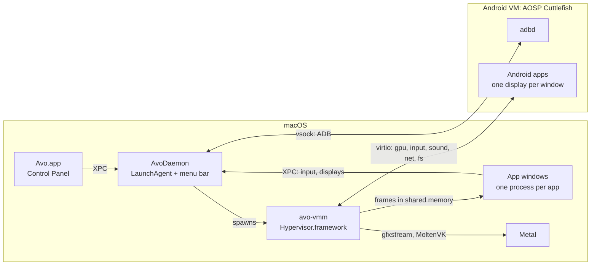

<p align="center">
  
</p>

<h1 align="center">Avo</h1>

<p align="center">Android apps and games on your Mac, each in its own window.<br>
Free and open source, for Macs with Apple silicon.</p>

<p align="center">
  <a href="https://github.com/nizwar/avo/releases"></a>
  <a href="LICENSE"></a>
  
  <a href="https://github.com/sponsors/nizwar"></a>
</p>

<p align="center">
  <a href="https://avodroid.com">Website</a> ·
  <a href="https://github.com/nizwar/avo/releases">Releases</a> ·
  <a href="docs/architecture.md">Architecture</a> ·
  <a href="docs/engine.md">Engine</a> ·
  <a href="docs/for-game-developers.md">For game developers</a> ·
  <a href="CHANGELOG.md">Changelog</a>
</p>

---

Avo runs a small Android system in the background and shows every Android
app as a regular Mac app: its own window and Dock icon, Launchpad and
Spotlight entries, ⌘Tab, notifications in Notification Center, a shared
clipboard, links that open in your Mac's browser, and drag and drop from
Finder. Games get keyboard, mouse and controller support, including a
shooter mode with mouse-look.

Under the hood Avo boots an unmodified AOSP image (Android 17, Cuttlefish)
in its own virtual machine on Apple's Hypervisor.framework, and draws it on
your Mac's GPU through gfxstream and Metal.

> **Status: before 1.0.** Avo is under active development. Its releases on
> [GitHub Releases](https://github.com/nizwar/avo/releases) are signed with a
> Developer ID and notarized, and from 0.4.0 on they update themselves.
> Expect rough edges, and please [report problems](#reporting-problems).

## Features

**Apps as Mac apps**
- One window per Android app, with its own Dock icon, Launchpad and
  Spotlight entries; full screen with the menu bar and title bar on hover.
- Notifications in Notification Center, with their buttons and Reply right
  from the banner; what Android plays in Control Center and on the media
  keys and AirPods; a shared clipboard;
  Android links open in the Mac's default browser.
- Install `.apk`, `.xapk`, `.apkm` and `.apks` files (OBB data included) by
  double-clicking, dropping them on Avo, or from Google Play.
- Android follows the Mac: dark mode, time zone, 24-hour clock, language and
  battery level.
- Screen translation (⌘⇧T), screenshots and screen recordings with sound,
  Keep on Top and Picture in Picture, and a shake of the phone for apps that
  listen for one.
- A shared folder between the Mac and Android, location from the Mac (or a
  place or route you choose), the Mac's microphone, and mock fingerprints for
  apps that ask for one.

**Games**
- Key mapping: put keys on a game's touch controls, with templates for
  shooters, MOBAs and racing games; profiles can be shared. Modes switch the
  layout with the game (on foot, in a vehicle), and one key may press several
  buttons.
- Shooter mode with mouse-look, and full game controller support with a
  visual controller editor.
- GPU rendering through gfxstream and MoltenVK, a frame-rate cap of 30, 60,
  90 or 120 fps (or the display's own rate), render scale and sharpening, and
  a persistent shader cache.
- Avo adds no auto-aim, macros or other advantages, and does not hide itself
  from games ([details for publishers](docs/for-game-developers.md)).

**System**
- Control Panel with an app library, Settings, and a System Status view of
  CPU, memory and GPU use per app.
- Menu bar item with quick controls; Android pauses itself when idle and
  resumes instantly when used.
- Choose the Android version, the device profile apps see, and where
  Android's data lives (including an external drive).
- Optional Google Play (installed from MindTheGapps on request), ADB support
  for `adb` and Android Studio, and `avoctl` for the command line.
- Report a Problem collects a redacted diagnostics archive.

## Requirements

- A Mac with Apple silicon (M1 or newer). Intel Macs are not supported.
- macOS 15 Sequoia or newer.
- At least 10 GB of free disk space: the Android image, and a data disk that
  grows as you use it.

Everything Avo needs is built in: its own gfxstream GPU renderer, the
Vulkan loader and MoltenVK, and Root Canal, Android's Bluetooth controller,
all built from source. You need no Android Studio or Android Emulator.

## Installing

1. Download `Avo-<version>-b<build>.dmg` from
   [Releases](https://github.com/nizwar/avo/releases) and drag Avo to
   Applications.
2. Open Avo. The Setup Assistant downloads an Android image from Google's
   public AOSP build server and starts Android. Allow the background item
   when macOS asks (System Settings › General › Login Items).

From 0.4.0 on, Avo updates itself (Settings › About). Earlier versions
can't, so install 0.4.0 over the one you have by hand. Your Android data
stays in `~/Library/Application Support/Avo`.

## Building from source

Requirements: Xcode 26 or later, [XcodeGen](https://github.com/yonaskolb/XcodeGen),
a Rust toolchain (`rustup`, stable) for the engine, and CMake and Ninja for
the GPU renderer. The Android SDK is needed only to rebuild the small Android
helpers, which are checked in.

The key mapping and the haze's window controls that Avo shares with Avo Hub
are [avo_kit](https://github.com/nizwar/avo_kit), a submodule at
`vendor/avo_kit`: clone with `--recurse-submodules`, or fetch it once:

```sh
git submodule update --init
```

```sh
make test       # host unit and integration tests (swift test)
make project    # generate host/Avo.xcodeproj
make gfxstream  # build the GPU renderer from source (once; about 6 minutes)
make build      # build Avo.app (Debug) into build/DerivedData
make helpers    # rebuild the Android helpers embedded in the daemon
cd engine/hvf && cargo test   # engine tests
```

Or open `host/Avo.xcodeproj` in Xcode and run the **Avo** scheme. A release
disk image is built with `scripts/build-dmg.sh` (see
[docs/releasing.md](docs/releasing.md)).

`avoctl` (in `Avo.app/Contents/MacOS`) drives the daemon from a terminal:

```sh
avoctl status
avoctl install ~/Downloads/F-Droid.apk
avoctl start
```

## How it fits together



| Document | Contents |
| --- | --- |
| [docs/architecture.md](docs/architecture.md) | Processes, windows, input, settings, storage, and how each feature works |
| [docs/engine.md](docs/engine.md) | avo-vmm: devices, GPU, sound, networking, pause, the daemon contract |
| [docs/protocol.md](docs/protocol.md) | Host ↔ guest channels and message formats |
| [docs/for-game-developers.md](docs/for-game-developers.md) | How apps can detect Avo, and what differs from a phone |
| [docs/releasing.md](docs/releasing.md) | Building, signing and publishing releases and updates |
| [docs/versioning.md](docs/versioning.md) | Version numbers, betas and build numbers, and when each goes up |
| [docs/zero-copy.md](docs/zero-copy.md) | What it would take to draw frames without copying them |
| [docs/brand.md](docs/brand.md) | Logo, colours and type |
| [docs/spec.md](docs/spec.md) | The original product specification (Indonesian) |

## Repository

```
branding/   Logo and app icon sources, and their generator
docs/       Architecture, engine, protocol and release documentation
engine/     avo-vmm and the Hypervisor.framework crates (Rust)
guest/      Android helpers Avo installs in the guest, and the AOSP product skeleton
host/       The macOS apps (Xcode project via XcodeGen) and the AvoKit Swift package
profiles/   Device profiles and keymap templates (JSON)
proto/      Host ↔ guest protocol (protobuf) and test vectors
scripts/    Code generation, image tools, the DMG and its update feed
website/    The project website (static, English and Indonesian)
```

## Limitations

- Android's back and front cameras are emulated, or show one of the Mac's
  cameras (Settings › Devices › Cameras); they have no flash, zoom or
  manual controls. Android's Bluetooth runs on a virtual controller Avo
  brings (Root Canal) and reaches the Bluetooth LE devices the Mac sees,
  like watches, sensors and beacons; classic Bluetooth (headsets) and
  pairing do not work yet.
- Apps that rely on hardware attestation (most banking and some DRM apps)
  generally do not run, and some online games refuse to run in a virtual
  machine. Avo does not try to get around that.
- 32-bit-only and x86-only apps cannot run on Apple silicon.

## Reporting problems

Use **Help › Report a Problem** in Avo to save a diagnostics archive (personal
data is redacted), then open an
[issue](https://github.com/nizwar/avo/issues) and attach it. Security issues:
see [SECURITY.md](SECURITY.md).

## Support Avo

Avo is free, and built and maintained by one independent developer. If it is
useful to you, you can support its development:

- [GitHub Sponsors](https://github.com/sponsors/nizwar), monthly or once
- [PayPal](https://paypal.me/nizwar)
- [Saweria](https://saweria.co/hangpuan) (Indonesia)

Support goes to the developer personally; it does not buy features or
priority help.

## Contributing

Contributions are welcome. See [CONTRIBUTING.md](CONTRIBUTING.md), the
[Code of Conduct](CODE_OF_CONDUCT.md) and [SUPPORT.md](SUPPORT.md).

### Contributors

Thank you to everyone who has made Avo better:

<a href="https://github.com/nizwar/avo/graphs/contributors">
  
</a>

<sub>Made with [contrib.rocks](https://contrib.rocks).</sub>

## Acknowledgements

Avo is developed with the help of Claude, Anthropic's AI model, as a coding
assistant. It builds on AOSP and Cuttlefish, gfxstream, MoltenVK and the
Vulkan loader, Root Canal, Sparkle, SwiftProtobuf and smoltcp; see
[NOTICE](NOTICE).

## License

Avo is licensed under the [Apache License 2.0](LICENSE). The engine crates in
`engine/hvf` are BSD-3-Clause. Android is a trademark of Google LLC; Avo is
not affiliated with Google or Apple. Device names in `profiles/devices` are
used only for app compatibility.
