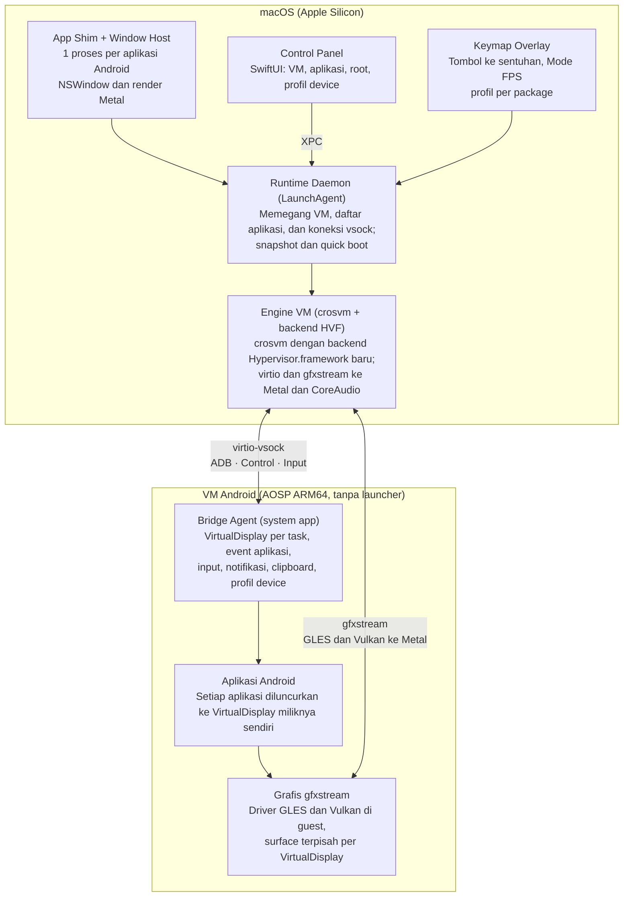

# Avo — Spesifikasi Teknis Android Runtime untuk macOS

> Dokumen sumber, 16 Oktober 2026, @Mochamad Nizwar Syafuan. Disalin dari PDF
> spesifikasi ke Markdown supaya bisa di-review lewat pull request. Catatan
> implementasi (bahasa Inggris) ada di [architecture.md](architecture.md).
>
> **Catatan implementasi.** Dokumen ini adalah spesifikasi awal dan disimpan
> apa adanya. Implementasinya berbeda di beberapa bagian, terutama Engine VM:
> Avo tidak memakai crosvm, tetapi engine sendiri, avo-vmm, yang menjalankan
> image AOSP Cuttlefish langsung di Hypervisor.framework (lihat
> [engine.md](engine.md)).

## Ringkasan dan tujuan

Avo menjalankan aplikasi Android di macOS sebagai aplikasi biasa: Android hidup
di VM latar belakang, dan setiap aplikasi Android tampil di jendela macOS-nya
sendiri. Proyek ini dibangun sebagai produk komunitas open source dan dibagikan
gratis.

Tujuan yang bisa diukur:

- Satu aplikasi Android = satu jendela macOS, lengkap dengan ikon di Dock,
  Launchpad, dan Spotlight.
- Double-click file APK langsung meng-install dan membuat shortcut, tanpa
  terminal.
- Game kasual dan menengah bisa dimainkan dengan keyboard, mouse, atau gamepad
  lewat keymapping overlay.
- Membuka aplikasi yang sudah ter-install terasa instan, karena VM tetap hidup
  di latar belakang.
- Semua pengaturan VM (RAM, CPU, storage, grafis, root, profil device) ada di
  satu control panel.

## Batasan dan non-goals

Batasan ini ditetapkan sejak awal supaya ruang lingkup tidak melebar dan janji
ke user tetap jujur.

| Area | Keputusan | Alasan |
| --- | --- | --- |
| Hardware | Apple Silicon saja (M1 ke atas) | Guest Android ARM64 jalan langsung lewat Hypervisor.framework tanpa translasi instruksi |
| Mac Intel | Tidak didukung | Butuh image x86 dan translasi ARM, sehingga beban maintenance jadi dua kali lipat |
| Google Play Services / Play Store | Tidak dibundel | Distribusi GMS butuh lisensi Google; lihat bagian Strategi GMS |
| Aplikasi bank, e-wallet, DRM | Tidak dijanjikan jalan | Play Integrity dan hardware attestation tidak bisa dilewati di VM |
| Game FPS kompetitif (PUBG Mobile, Delta Force) | Target utama | Sebagian game online bisa mendeteksi VM yang tidak dikenal dan menolak berjalan; produk tidak menyediakan fitur apa pun di luar yang ada di ponsel |
| Mac App Store | Bukan target distribusi | Butuh entitlement hypervisor dan akses sistem di luar sandbox |

## Arsitektur tingkat tinggi

Semua bagian di macOS berbicara dengan satu Runtime Daemon, dan semua bagian di
Android berbicara dengan satu Bridge Agent. Keduanya terhubung lewat vsock dan
gfxstream di dalam Engine VM.

App Shim dan Window Host berjalan di proses yang sama, supaya setiap aplikasi
Android dianggap aplikasi terpisah oleh Dock dan Cmd+Tab.

## Komponen guest Android

Guest-nya adalah image AOSP ARM64 tanpa launcher. Satu system service buatan
sendiri (kita sebut "Bridge Agent") menjadi satu-satunya penghubung ke macOS.

**Image dasar**

- Base: AOSP 16 atau lebih baru dengan target `arm64`, varian `userdebug` untuk
  development dan `user` untuk rilis.
- Launcher3 dihapus. SystemUI dikurangi sampai tidak ada status bar, navigation
  bar, maupun recents.
- Home default diganti activity kosong milik Bridge Agent, supaya tidak ada
  layar "home" yang terlihat.
- Kernel dikonfigurasi untuk virtio: virtio-gpu, virtio-input, virtio-vsock,
  virtio-blk, virtio-snd, dan virtio-balloon.

**Bridge Agent (privileged system app, ditandatangani platform key)**

- Membuat satu `VirtualDisplay` per task. Setiap aplikasi yang dibuka
  diluncurkan ke display miliknya sendiri lewat
  `ActivityOptions.setLaunchDisplayId`.
- Mengirim event ke host: aplikasi ter-install atau terhapus (`PACKAGE_ADDED` /
  `PACKAGE_REMOVED`), ikon dan label, task dibuka atau ditutup, serta orientasi
  dan ukuran yang diminta aplikasi.
- Menerima perintah dari host: launch, close, resize display, inject input,
  install, uninstall, clear data, dan force stop.
- Meneruskan notifikasi lewat `NotificationListenerService` dan clipboard lewat
  `ClipboardManager` listener.
- Menerapkan override properti device (profil spoof) dan status root saat boot.

**Grafis**

- gfxstream sebagai jalur GLES dan Vulkan ke host. gfxstream juga dipakai
  Android Emulator dan Cuttlefish, dan sudah terintegrasi dengan crosvm lewat
  rutabaga.
- Setiap VirtualDisplay memiliki surface sendiri yang direnders di host, jadi
  frame tidak perlu di-encode menjadi video.

## Komponen host macOS

Di sisi macOS ada satu daemon yang memegang VM, ditambah beberapa aplikasi kecil
yang semuanya berbicara dengan daemon itu lewat XPC.

| Komponen | Bentuk | Tugas |
| --- | --- | --- |
| Runtime Daemon | LaunchAgent (Swift + engine VM) | Menjalankan, menghentikan, dan membuat snapshot VM; memegang koneksi vsock ke Bridge Agent; menjadi satu sumber kebenaran untuk daftar aplikasi |
| Engine VM | crosvm (Rust) dengan backend hypervisor baru untuk Hypervisor.framework; device virtio dan gfxstream (rutabaga) dipakai ulang | Virtualisasi CPU, memori, disk, dan perangkat virtio; meneruskan perintah grafis ke Metal |
| Window Host | Framework Swift/AppKit yang berjalan di dalam proses App Shim, satu NSWindow per VirtualDisplay | Merender surface lewat Metal, meneruskan input keyboard, mouse, dan trackpad, menangani resize, resolusi internal, dan upscaling MetalFX |
| App Shim | Bundle `.app` kecil per aplikasi Android di `~/Applications/Android Apps/` | Memberi ikon sendiri di Dock, Launchpad, dan Spotlight; saat dibuka, mengirim perintah launch package ke daemon |
| Control Panel | Aplikasi SwiftUI | Pengaturan VM, daftar aplikasi, root, profil device, dan editor keymapping |
| Keymap Overlay | Panel transparan di atas jendela game | Editor tombol dan runtime yang menerjemahkan tombol menjadi sentuhan |
| Menu Bar Item | `NSStatusItem` | Status VM, tombol start/stop, dan pintasan ke Control Panel |

**Kenapa App Shim, bukan alias di Desktop:** alias hanya membuka aplikasi utama,
sehingga semua jendela Android menumpuk di satu ikon Dock. Dengan shim, tiap
aplikasi Android punya identitas proses sendiri, sehingga Cmd+Tab, Dock, dan
Mission Control memperlakukannya sebagai aplikasi terpisah. Ini pola yang sama
dengan cara Chrome membuat PWA.

## Protokol host-guest

Semua komunikasi berjalan lewat virtio-vsock, tidak lewat jaringan TCP, supaya
tidak ada port yang terbuka di Mac.

| Kanal | Port vsock | Isi |
| --- | --- | --- |
| ADB | 5555 | Install dan uninstall APK, `pm`, `am`, logcat, debugging |
| Control | 6000 | Perintah dan event Bridge Agent dalam format protobuf: launch, close, resize, daftar aplikasi, notifikasi, clipboard |
| Input | 6001 | Event multitouch, keyboard, dan gamepad bervolume tinggi, dipisah dari kanal Control supaya latensinya rendah |
| Grafis | gfxstream (pipe tersendiri) | Perintah GLES dan Vulkan per display |

Pesan utama di kanal Control:

- Host ke guest: `Launch(package, displayId, width, height, dpi)`,
  `Resize(displayId, w, h)`, `Close(displayId)`, `Install(path)`,
  `Uninstall(package)`, `SetClipboard(text)`, `ListApps()`.
- Guest ke host: `AppInstalled(package, label, iconPng, versionName)`,
  `AppRemoved(package)`, `DisplayReady(displayId)`, `TaskClosed(displayId)`,
  `Notification(package, title, body, key)`, `ClipboardChanged(text)`,
  `OrientationRequest(displayId, orientation)`.

Setiap pesan membawa nomor versi protokol, supaya host dan image Android bisa
di-update secara terpisah.

## Spesifikasi fitur

Setiap poin brief dijabarkan menjadi perilaku yang bisa diuji.

### 1. Android tanpa launcher

- Tidak ada home screen, status bar, atau navigation bar yang pernah terlihat
  oleh user.
- Tombol Back dipetakan ke Esc dan swipe trackpad dua jari ke kiri. Home dan
  Recents tidak ada, karena perannya sudah digantikan Dock dan Mission Control.
- Play Store tidak dibundel; lihat bagian Strategi GMS.

### 2. Daftar aplikasi native di macOS

- Control Panel menampilkan grid aplikasi yang ter-install, lengkap dengan ikon,
  nama, versi, dan ukuran.
- Daftarnya diperbarui secara live dari event `AppInstalled` dan `AppRemoved`,
  termasuk aplikasi yang di-install dari dalam Android (misalnya lewat F-Droid
  atau Aurora Store).
- Setiap aplikasi otomatis punya App Shim, sehingga muncul di Launchpad dan
  Spotlight.

### 3. Install dari file APK

- Daftarkan file association untuk `.apk`, `.xapk`, `.apkm`, dan `.apks`.
  Double-click pada file akan memunculkan sheet konfirmasi berisi nama, versi,
  dan izin, lalu meng-install.
- Drag file ke ikon Dock atau ke jendela Control Panel juga akan meng-install.
- Split APK dipasang dengan `pm install-create` / `install-write` /
  `install-commit`. OBB dari XAPK disalin ke `/sdcard/Android/obb/`.
- Kalau VM belum jalan, daemon menyalakannya terlebih dahulu, dan progres
  ditampilkan di sheet.

### 4. Shortcut otomatis

- Setiap install membuat App Shim di `~/Applications/Android Apps/`, dengan
  ikon Android diubah ke format `.icns` (adaptive icon dirender di atas squircle
  macOS).
- Opsi di Control Panel: "Buat alias di Desktop" (default menyala sesuai brief)
  dan "Tambahkan ke Dock".
- Uninstall akan menghapus shim dan alias-nya.

### 5. Keymapping overlay untuk game

- Tekan Cmd+Shift+K di jendela game untuk membuka editor overlay transparan.
- Jenis kontrol: tap, hold, D-pad (WASD), aim dengan mouse (pointer lock),
  swipe, tap berulang, dan makro sederhana.
- Profil disimpan per package dalam format JSON. Profil bisa diekspor dan
  diimpor, sehingga komunitas bisa berbagi profil game.
- Gamepad didukung lewat GameController.framework, dengan pemetaan ke tombol
  overlay yang sama.
- Sentuhan disuntikkan sebagai multitouch lewat kanal Input ke virtio-input.

### 5a. Mode FPS (PUBG Mobile, Delta Force, dan game sejenis)

- **Mouse-look:** pointer lock di macOS. Gerakan mouse mentah (tanpa akselerasi)
  diterjemahkan menjadi drag sentuhan berkelanjutan di area kamera. Saat drag
  mencapai tepi area, sentuhan diangkat dan dimulai ulang dari tengah tanpa
  terlihat (re-centering), sehingga kamera bisa berputar tanpa batas.
- **Sensitivitas:** sumbu X dan Y diatur terpisah, ada kurva dan deadzone, serta
  sensitivitas terpisah saat membidik (ADS/scope).
- **Tombol mouse:** klik kiri untuk tembak, klik kanan untuk ADS (tahan atau
  toggle), scroll untuk ganti senjata, dan tombol samping mouse bisa di-map.
- **Mode kursor:** tombol toggle (default Alt) untuk keluar dari pointer lock
  saat membuka inventory atau peta. Layout kontrol berganti otomatis sesuai
  konteks.
- **Multitouch serentak:** minimal 10 titik sentuh, supaya WASD, kamera, tembak,
  lompat, dan jongkok bisa ditekan bersamaan.
- **Latensi:** target input di bawah satu frame pada 120 FPS, lewat kanal Input
  yang terpisah dari kanal Control.
- **Profil bawaan:** profil untuk game FPS populer disediakan dan dikelola
  komunitas.
- **Grafis:** preset "Game berat" dengan rendering GPU, batas FPS 90/120,
  rekomendasi RAM VM minimal 8 GB, dan game di 720p 16:9 dengan upscaling
  MetalFX.
- **Batas tegas:** tidak ada makro recoil, auto-aim, atau rapid fire otomatis.
  Fitur seperti itu melanggar aturan banyak game dan memperbesar risiko akun
  user di-ban.
- **Risiko deteksi VM:** sebagian game online bisa menolak berjalan atau mem-ban
  akun di VM yang tidak dikenali. Avo tidak menyembunyikan diri dari aplikasi
  yang memeriksanya. Status tiap game dicatat di daftar kompatibilitas komunitas.

### 6. Control Panel

| Tab | Pengaturan | Perlu restart VM |
| --- | --- | --- |
| Performa | RAM (2–16 GB), jumlah CPU core, ballooning saat idle | Ya |
| Storage | Ukuran disk data (bisa diperbesar, tidak bisa diperkecil), lokasi file image, bersihkan cache | Ya, untuk resize |
| Grafis | Renderer (Otomatis, GPU (Metal) lewat gfxstream dari Android Emulator 37+, atau Software; GPU yang gagal dimulai kembali ke Software sampai "Coba GPU Lagi"), batas FPS (30/60/120), resolusi dan penskalaan per profil Aplikasi/Game (ikuti jendela × skala render, atau resolusi tetap 540p–1080p dengan rasio aspek), ukuran tampilan, filter MetalFX/Bilinear/Nearest, ketajaman, HUD performa, pengaturan per aplikasi | Sebagian |
| Display | Ukuran jendela default, mode portrait atau landscape | Tidak |
| Aplikasi | Uninstall, force stop, clear data, izin, buka info aplikasi | Tidak |
| Sidik Jari | Daftarkan jari dengan nama (maksimal 5), ganti nama, hapus | Tidak |
| Sistem | Versi Android, root, profil device, snapshot, reset Android | Ya |

### 7. Opsi root (checkbox)

- Implementasinya kini Magisk: salinan init_boot image yang di-patch Magisk
  (`MagiskRoot`, docs/engine.md "Root"), menggantikan rancangan awal berupa
  dua overlay partisi `system` (stock dan rooted, KernelSU).
- Mencentang opsi ini menukar overlay saat boot berikutnya, tanpa menyentuh data
  user.
- Saat dicentang, tampilkan peringatan bahwa aplikasi yang memeriksa integritas
  akan menolak berjalan.

### 8. Mock nama sistem (profil device)

- Dropdown berisi template seperti Samsung Galaxy S24 Ultra, Google Pixel 9 Pro,
  Xiaomi 14, ASUS ROG Phone 8, dan OnePlus 12, ditambah opsi "Custom".
- Setiap template berisi `ro.product.brand`, `ro.product.manufacturer`,
  `ro.product.model`, `ro.product.device`, `ro.build.fingerprint`, dan resolusi
  atau DPI yang sesuai.
- Override diterapkan lewat resetprop saat boot. Ganti profil butuh restart VM.
- Template disimpan sebagai file JSON di repo, sehingga komunitas bisa menambah
  template lewat pull request.
- Peringatan di UI: profil ini mengubah identitas yang dibaca aplikasi, tetapi
  tidak meloloskan hardware attestation.

**Emulasi hardware (checkbox "Emulate this phone's hardware").** Untuk
developer: selain nama/model, template bisa membawa blok `hardware` (SoC, CPU,
GPU) sehingga aplikasi menjalankan jalur kode per-perangkat — misalnya cek
"ini Snapdragon?" atau cek merek — seperti di perangkat aslinya. Mencentang
kotak ini menerapkannya; tanpa dicentang (dan untuk identitas jujur Avo yang
tak punya hardware) profil hanya mengubah nama. Jalurnya, sesuai cara aplikasi
membaca hardware:

- **SoC** — properti read-only saat boot: `ro.soc.manufacturer`/`ro.soc.model`
  (`Build.SOC_MANUFACTURER`/`SOC_MODEL`), `ro.board.platform` (codename yang
  dibaca pustaka deteksi SoC), `ro.product.board` (`Build.BOARD`), plus kunci
  vendor (`ro.vendor.qti.*` Snapdragon, `ro.vendor.mediatek.*`/`ro.mediatek.*`
  Dimensity). Ini jalur utama — hampir semua cek chipset lewat sini.
- **GPU** — dua layer melaporkan GPU profil ke renderer milik aplikasi: layer
  GLES (`libGLES_avo_profile.so`) menjawab `glGetString` (`GL_VENDOR`,
  `GL_RENDERER`, `GL_VERSION`) dengan GPU profil alih-alih ANGLE, dan Vulkan
  layer (`VK_LAYER_AVO_profile`) menjawab `VkPhysicalDeviceProperties` (nama,
  vendorID, driver). GLES tetap digambar ANGLE di GPU Mac (ekstensi tetap
  milik ANGLE); SurfaceFlinger, HWUI, WebView dan instance Vulkan milik ANGLE
  sengaja tidak disentuh agar layar tetap benar.
- **CPU** — mesin melaporkan model inti tiap cluster (MIDR) dan frekuensinya,
  sehingga `/proc/cpuinfo` dan `/sys/devices/system/cpu` cocok dengan target
  (satu policy cpufreq per cluster). Frekuensinya hanya nama: tiap vCPU tetap
  berjalan secepat Mac mengizinkan.
- Yang tetap jujur dan tak dipalsukan (mengubahnya memecah aplikasi/driver):
  `ro.hardware` dan HAL, daftar ABI, level API, dan kemampuan GPU sebenarnya.
  Aplikasi yang bercabang pada `.so`/HAL khusus-Qualcomm tetap jatuh ke jalur
  fallback — dan itu justru informasi yang berguna bagi developer. Avo juga
  tetap menyatakan dirinya (`ro.boot.avo.*`, `dev.avo.feature.MAC`), apa pun
  profilnya; ini bukan untuk mengelabui attestation.

### Fitur native tambahan (di luar brief, tapi menentukan kesan native)

- Notifikasi Android muncul di Notification Center macOS, dan meng-klik
  notifikasi akan membuka jendela aplikasinya.
- Clipboard tersinkron dua arah.
- Drag file dari Finder ke jendela aplikasi akan menyalinnya ke `/sdcard/Download`
  dan memicu share intent.
- Gestur trackpad diterjemahkan ke gerakan Android: scroll dua jari, pinch untuk
  zoom, dan swipe.
- Kamera, mikrofon, dan lokasi diteruskan dengan prompt izin bawaan macOS.
  Kamera belakang dan depan Android masing-masing bisa emulasi, tidak ada,
  atau salah satu kamera Mac (Pengaturan › Perangkat › Kamera); kamera Mac
  hanya menyala selama app Android memakainya.
- Audio lewat virtio-snd ke CoreAudio.
- Quick boot dari snapshot, dan VM tetap jalan di latar belakang dengan memori
  yang dikembalikan saat idle.
- Mock sidik jari: jari yang didaftarkan dengan nama di Control Panel
  (Pengaturan › Sidik Jari) di-enroll Avo sendiri ke stack sidik jari Android
  (sensor virtual AOSP di image userdebug), jadi aplikasi (BiometricPrompt) dan
  layar kunci melihat sidik jari terdaftar. Menu Device › Fingerprint di
  title bar jendela aplikasi berisi jari-jari itu: memilih satu jari
  menyentuh sensor dengan jari tersebut; "Jari Tak Terdaftar" menyentuh dengan
  jari yang tidak dikenali; "Kelola Sidik Jari…" membuka Control Panel. Prompt
  sidik jari aplikasi tampil di layar Android sendiri (tidak terlihat di
  jendela), jadi selama aplikasi itu atau layar kunci meminta sidik jari, menu
  yang sama muncul juga sebagai tombol biru sendiri di title bar. Android hanya menerima sidik jari jika ada kunci layar (PIN, pola,
  atau sandi); menghapus kunci layar, atau Reset Android, menghapus semua
  sidik jari. Lima jari salah mengunci sidik jari 30 detik, dua puluh
  berturut-turut sampai kunci layar dimasukkan. Batasan: sensor virtual tidak
  menandatangani token perangkat keras, jadi aplikasi yang membuka kunci
  kriptografi (CryptoObject) dengan sidik jari menerima sentuhannya tetapi
  tidak bisa memakai kunci itu.

### Setup awal dan versi Android

- Avo tidak membundel Android. Saat pertama dibuka, dan selama belum ada
  image Android yang bisa dipakai, Control Panel menampilkan Asisten
  Pengaturan: Selamat Datang, Versi Android, Izin (notifikasi, mikrofon,
  lokasi, masing-masing dengan kegunaan dan tombolnya), Aplikasi Google
  (opsional, menunjuk ke penginstal di Pengaturan › Sistem), lalu Siap:
  Android dijalankan dan progresnya ditampilkan. Bantuan › Asisten
  Pengaturan… membukanya lagi.
- Daftar versi diambil dari Android Build API publik Google (yang dipakai
  ci.android.com dan `scripts/fetch-cuttlefish.sh`): build sukses terbaru
  dari setiap versi Android, minimal Android 16, untuk target
  `aosp_cf_arm64_only_phone-userdebug`, dengan nomor build, tanggal, dan
  ukuran unduhan. Endpoint, API key, branch, dan target diatur di satu tempat
  (`AndroidBuildSource`).
- Unduhan bisa dijeda, dilanjutkan (juga setelah Avo ditutup), dan
  dibatalkan. Ruang disk diperiksa sebelum mengunduh, dan unduhan dicocokkan
  dengan MD5 dari API sebelum diekstrak. "Pakai Image di Mac Ini…" menerima
  zip image, folder berisi file `.img`, atau folder hasil
  `fetch-cuttlefish.sh`, dan memeriksanya dulu (arm64, userdebug, Android 16
  atau lebih baru).
- Image Cuttlefish adalah build Google, jadi tidak ditandatangani Avo: setelah
  diperiksa, SHA-256 dan ukuran setiap file dicatat di `manifest.json`, dan
  daemon memeriksanya sebelum Android dijalankan.
- Pengaturan › Sistem › Versi Android menampilkan versi dan build yang
  terpasang, serta "Ganti Versi Android…" dengan peringatan yang jelas: naik
  versi tetap menyimpan aplikasi dan data; kembali ke Android yang lebih lama
  tidak bisa dengan data yang sama (data Android dihapus dulu); aplikasi
  Google harus sesuai dengan versi Android. Versi sebelumnya disimpan agar
  bisa kembali.

## Strategi GMS untuk komunitas

Keputusannya: image resmi tidak berisi komponen Google. Sebagai gantinya, user
diberi tiga jalur yang bisa dipilih saat setup pertama.

| Jalur | Isi | Kelebihan | Kekurangan |
| --- | --- | --- | --- |
| Tanpa GMS (default) | AOSP murni + F-Droid atau Aurora Store | Paling bersih secara lisensi, paling ringan | Aplikasi yang bergantung pada Play Services (FCM, Maps, login Google) bisa error |
| microG | microG dengan signature spoofing yang dibatasi untuk microG | Push notification dan sebagian API Google jalan, open source | Kompatibilitasnya tidak 100%; beberapa aplikasi tetap menolak |
| Bring your own GApps | Wizard yang memasang paket GApps yang di-download sendiri oleh user | Play Store asli tersedia | Device harus didaftarkan sebagai "uncertified" lewat halaman registrasi Google; proyek tidak mendistribusikan file Google |

Yang tidak dilakukan: mendistribusikan APK Google di repo, rilis, atau mirror.
Wizard hanya menerima file dari user dan memasangnya.

## Distribusi, lisensi, dan keamanan

Rilis dibagikan sebagai DMG yang ditandatangani Developer ID dan sudah
di-notarize, dengan update otomatis lewat Sparkle.

**Distribusi**

- Pengguna cukup mengunduh DMG dan menyeret aplikasinya ke folder Applications.
  Image Android (sekitar 1–2 GB) diunduh saat setup pertama, bukan dibundel di
  DMG (lihat "Setup awal dan versi Android").
- Entitlement yang dibutuhkan: `com.apple.security.hypervisor` untuk VM, serta
  kamera dan mikrofon yang diminta hanya saat dipakai.
- Biaya Apple Developer Program (USD 99 per tahun) diperlukan untuk
  notarization. Ini satu-satunya biaya tetap proyek.
- Channel rilis: stable dan beta di GitHub Releases. Image Android diberi versi
  terpisah dari aplikasi macOS.

**Lisensi**

- Kode host dan Bridge Agent: Apache 2.0, supaya sejalan dengan AOSP. crosvm
  berlisensi BSD-3, jadi fork-nya tetap kompatibel.
- Komponen GPL (kernel Linux dan KernelSU) dipisahkan dengan jelas, dan
  source-nya dipublikasikan sesuai kewajiban GPL.
- Merek Android, Google Play, dan nama brand di template device hanya dipakai
  untuk keperluan kompatibilitas, bukan untuk branding produk.

**Keamanan**

- Kanal vsock hanya bisa diakses oleh proses daemon; tidak ada port TCP yang
  terbuka.
- ADB tidak pernah diekspos ke jaringan.
- App Shim berkomunikasi dengan daemon lewat XPC dengan validasi code signature
  pemanggil.
- Image Android diverifikasi dengan checksum dan tanda tangan sebelum dipasang.

## Roadmap MVP

Pengerjaan dibagi menjadi empat fase. Setiap fase baru dianggap selesai setelah
gerbangnya terpenuhi, dan hasilnya sudah bisa dirilis sebagai beta.

| Fase | Isi | Gerbang |
| --- | --- | --- |
| 1 · Fondasi | VM Android headless boot di Apple Silicon, Bridge Agent dan kanal vsock berjalan. Install APK lewat ADB, semua aplikasi tampil di satu jendela, daftar aplikasi dasar | APK di-install dari Finder dan aplikasinya bisa dipakai |
| 2 · Native | Satu VirtualDisplay per task, satu NSWindow per aplikasi, App Shim di Dock dan Launchpad. Notifikasi, clipboard, drag and drop, gestur trackpad, quick boot dari snapshot | 50 aplikasi uji berjalan di jendelanya sendiri |
| 3 · Gaming | Keymapping overlay, Mode FPS (mouse-look, ADS, re-centering), profil per package. Gamepad lewat GameController.framework, preset grafis Game berat (Vulkan, 90/120 FPS) | Delta Force, PUBG Mobile, Genshin Impact, dan Clash of Clans bisa dimainkan |
| 4 · Kontrol penuh | Control Panel lengkap, checkbox root, dropdown profil device. Wizard GMS: tanpa GMS, microG, atau bring your own GApps | Rilis publik 1.0 di GitHub Releases |

Fase 2 sengaja ditempatkan sebelum gaming: tanpa jendela per aplikasi, produk ini
tidak ada bedanya dengan emulator biasa.

## Risiko dan pertanyaan terbuka

Risiko terbesar ada di jalur grafis dan di multi-display, karena dua hal ini
paling menentukan apakah produk terasa native.

| Risiko | Dampak | Mitigasi |
| --- | --- | --- |
| Performa gfxstream ke Metal kurang untuk game berat | Tinggi | Ukur sejak Fase 1 dengan game acuan, terutama Genshin Impact, PUBG Mobile, dan Delta Force; siapkan jalur Venus/Vulkan lewat MoltenVK sebagai alternatif |
| Aplikasi menolak jalan di VirtualDisplay sekunder | Tinggi | Uji 50 aplikasi populer di Fase 2; sediakan fallback "mode jendela tunggal" untuk aplikasi yang bermasalah |
| Play Integrity membuat aplikasi populer gagal | Sedang | Komunikasikan dengan jelas di README dan UI; kelola daftar kompatibilitas yang diisi komunitas |
| Update macOS mengubah perilaku Hypervisor.framework | Sedang | Ikuti rilis beta macOS dan uji di CI pada mesin Apple Silicon |
| Beban maintenance AOSP setiap rilis Android baru | Sedang | Tetap di satu versi AOSP stabil per tahun; patch Bridge Agent dibuat seminimal mungkin |
| Biaya mesin CI Apple Silicon | Rendah | Mulai dengan self-hosted runner di Mac kontributor |
| crosvm belum mendukung macOS (saat ini hanya KVM, WHPX, dan backend lain non-Apple) | Tinggi | Backend HVF ditulis di crate hypervisor crosvm memakai binding Rust Hypervisor.framework; dikerjakan di awal Fase 1 sebagai pekerjaan terbesar |

**Pertanyaan terbuka**

- [x] Nama proyek: Avo.
- [x] Versi AOSP: 16 atau lebih baru.
- [x] Engine VM: crosvm, dengan backend Hypervisor.framework yang ditulis sendiri.
- [x] Root: Magisk (KernelSU direncanakan semula; image Cuttlefish tidak membawanya).
- [x] Game acuan: Delta Force, PUBG Mobile, Genshin Impact, Clash of Clans,
  ditambah game lain usulan komunitas.
- [x] Logo: arah C, "Monogram a" (lihat [brand.md](brand.md)).
- [ ] Daftar 50 aplikasi uji untuk kriteria kompatibilitas.
- [ ] Cek ketersediaan nama Avo di GitHub, domain, dan Homebrew.
